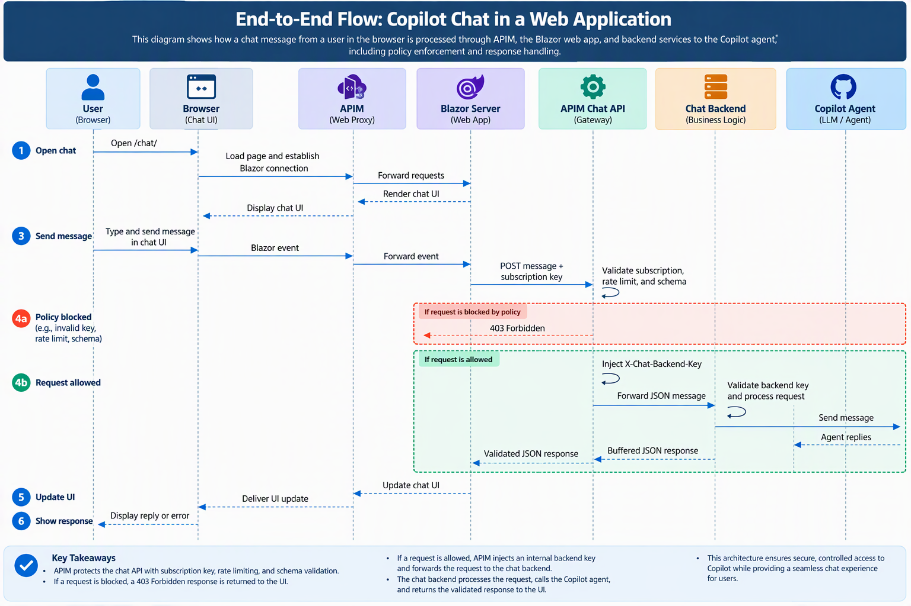
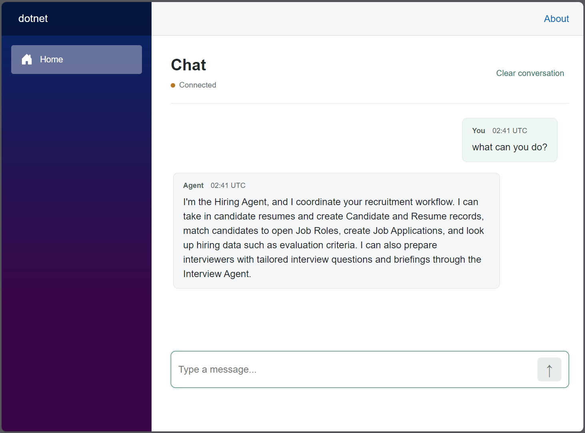

# Copilot Studio Chat

This repository contains a chat client for Copilot Studio agents, deployed with
Azure API Management (APIM) for governance and observability.

## Architecture

- APIM forwards browser requests to the Blazor chat server.
- The server sends chat messages through APIM policies to the protected chat
  backend.
- The backend connects to the Copilot Studio agent through Direct Line.

## Benefits

Copilot Studio supports anonymous access, but it offers limited rate limiting, and
its Direct Line endpoint is visible in browser network traffic. The agent also uses a
more complex Direct Line protocol than typical chat bots, with conversation tokens,
a server-side WebSocket stream, and watermark-based reconnection. This client handles
that protocol on the server, so the browser doesn't need to.

With this architecture, APIM is the entry point, and agent connection details and
conversation tokens stay on the server, out of the browser. APIM also adds governance
in one place, including subscription checks, rate limits, request validation, and
diagnostics. You can extend these controls with more policies without changing the
chat code.

## APIM governance

In this architecture, governance is configured in APIM at both touch points: the request
before it is forwarded to the agent, and the reply before it returns to the page. Policies defined
there apply to all chat traffic without any changes to the chat code. The diagram below
shows where those policies run.

APIM policies cover the most common governance needs for an API. They can limit call rates
and quotas, restrict callers by IP address or identity token, validate request and response
content against a schema, and rewrite headers or bodies. They can also route traffic across
backends, cache responses, and send logs and metrics to monitoring tools. The sample setup
uses a small subset of these policies to show the pattern.

To learn more, read the [APIM policy overview](https://learn.microsoft.com/en-us/azure/api-management/api-management-howto-policies)
and the [policy reference](https://learn.microsoft.com/en-us/azure/api-management/api-management-policies).

## Installation

Before you start, you need:

- The .NET 10 SDK ([details](development.md#prerequisites)).
- An Azure subscription with permission to deploy resources.
- An Azure Container Registry ([setup guide](docs/azure-container-registry.md)).
- An Azure Container Apps environment ([setup guide](docs/azure-container-apps.md)).
- An APIM instance ([setup guide](docs/azure-api-management.md)).
- A published Copilot Studio agent with anonymous access ([agent setup](docs/copilot-studio-setup.md#enable-anonymous-chat)).

Configure each component in the order below.

### Deploy Copilot Studio agent

The copilot agent has extensive capabilities ( not covered in this guide ). Once it has 
been configured, we will need its direct line endpoint and a token URL so that the chat 
client can communicate with the agent:

- **Anonymous token URL:** Needed to obtain a token that authorizes communication with 
the agent's Direct Line channel.
- **Regional Direct Line API URL:** Needed to connect the server to the agent
  through Direct Line to start conversations, send messages, and receive replies.

Follow the [Copilot Studio setup guide](docs/copilot-studio-setup.md) to configure
the agent and get these URLs. You'll add them to the application settings later.

### Deploy Azure Container Registry and Container Apps

The **Azure Container Registry** stores the chat server's container image, and **Azure
Container Apps** runs that image with the chat settings.

- **Azure Container Registry:** Needed for application images published from this repo.

Follow the [Container Registry guide](docs/azure-container-registry.md)
to build and push the image

- **Azure Container Apps:** Uses the uploaded container image to run the chat server.

Follow the [Container Apps guide](docs/azure-container-apps.md)
to deploy the clhat server and then and configure the chat settings.

### Deploy Azure API Management

This setup uses APIM to expose the chat interface to users and apply configurable
policies to each conversation turn.

- **Passthrough API:** Routes browser requests to the Blazor chat server.
- **WebSocket API:** Relays the SignalR WebSocket connection between the browser
  and the Blazor server.
- **Turns API:** Applies governance policies to each conversation turn through
  an endpoint called by the chat server.
- **Shared Key:** This key ensures that only the APIM is allowed to communicate with the chat server.
 
Follow the [APIM setup guide](docs/azure-api-management.md) to configure these APIs
and the shared key in your existing APIM instance.

### Local development

For local setup, connection verification, runtime behavior, and optional SDK
authentication, see [Build, Run, and Deploy the Chat Service](development.md).

## Using the chat interface

> [!NOTE]
> The chat UI is built with Blazor and can be customized to suit your needs.

1. Open your configured APIM URL at `https://<apim-host>/chat/`.
2. Enter a message in **Type a message...**, then press **Enter** or select the
   send button.
3. Wait for the agent's reply. Your messages appear as **You**, and replies
   appear as **Agent**.
4. Send follow-up questions to continue the conversation. Select **Clear
   conversation** to start a new one.

While a reply is pending, the page shows **Waiting for agent...** and disables
the message input. If a request fails, an error message appears above the input.

## Security

Since the page is anonymous, keep this demo on a trusted network; add access
controls and usage limits before exposing it publicly with a shared application
identity.

