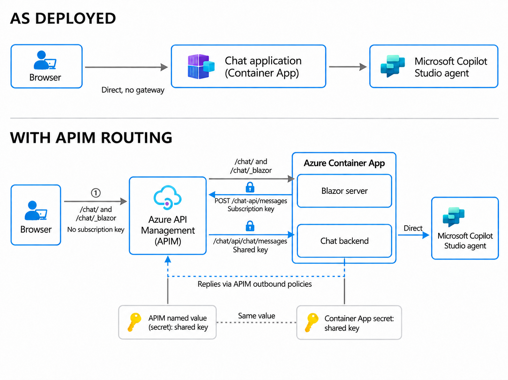

# Azure API Management

Use Azure API Management (APIM) to serve the chat interface and apply policies
to chat messages. 

## Prerequisites

- An APIM instance that is not on the Consumption Tier.

  [APIM quickstart](https://learn.microsoft.com/en-us/azure/api-management/get-started-create-service-instance).

- The chat service to Azure Container Apps (ACA).

  [See the previous deployment step](azure-container-apps.md).

- Make sure APIM can reach the app's ingress over HTTPS and WSS on port 443.

## Configure APIM message routing

As deployed, the **Azure Container Apps (ACA)** app connects directly to the
**Microsoft Copilot Studio agent** through `Direct Line`. To apply governance
policies, change the configuration so that the ACA app receives requests only
through APIM.

With APIM, the browser opens `https://<apim-host>/chat/`, and APIM forwards the
interface requests and the Blazor WebSocket connection to the **ACA** app. For each
chat turn, the Blazor server in **ACA** sends the message to **APIM** at
`/chat-api/messages`. The **APIM** applies its inbound policies and forwards the request
to the protected ACA backend at `/chat/api/chat/messages`. The ACA app then
connects to the **Microsoft Copilot Studio agent**. The complete reply returns
through APIM's outbound policies to the Blazor server, which displays it in the
browser.



### Routing and security

We will need three API's, one for each purpose listed below:

| Route | Protocol | Purpose | Required keys |
| --- | --- | --- | --- |
| `/chat/` and `/chat/*` | HTTPS | Load the chat interface and assets. | None |
| `/chat/_blazor` | WSS | Connect the browser to the Blazor server. | None |
| `/chat-api/messages` | HTTPS | Route chat turns from the Blazor server through APIM to the ACA backend. | **To&nbsp;APIM:**&nbsp;Subscription&nbsp;key<br>**To ACA:**&nbsp;Backend key |

#### API 1: Chat interface and assets

1. In the Azure portal, open your API Management instance and select **APIs** > **Add API** > **OpenAPI**.
2. In the dialog, select **Full** and upload [api1-chatassets.yml](../apim/api1-chatassets.yml) with **Select a file**.
3. Set **Display name** to `chat-web` and **URL suffix** to `chat`.
4. Set **Backend URL** to `https://<aca-host>/chat`, replacing `<aca-host>` with your Container App's hostname. This overrides the `servers` URL in the file.
5. Select **Create**.
6. Under the new API's **Settings**, turn off **Subscription required** to allow anonymous access.
7. Add a `POST` and a `DELETE` operation for both `/` and `/*`. The file defines only `GET`. These operations pass through pages, static assets, and Blazor startup requests.

#### API 2: WebSocket

1. In the Azure portal, open your API Management instance and select **APIs** > **Add API** > **WebSocket**.
2. Set **Display name** to `chat-websocket` and **URL suffix** to `chat/_blazor`.
3. Set **Web service URL** to `wss://<aca-host>/chat/_blazor`, replacing `<aca-host>` with your Container App's hostname.
4. Select **Create**. APIM creates the `onHandshake` operation automatically.
5. Under the new API's **Settings**, turn off **Subscription required** to allow anonymous access.

#### API 3: chat-api/messages

1. In the Azure portal, open your API Management instance and select **APIs** > **Add API** > **OpenAPI**.
2. In the dialog, select **Full** and upload [chat-api.openapi.json](../apim/chat-api.openapi.json) with **Select a file**.
3. Set **Display name** to `chat-api` and **URL suffix** to `chat-api`. Do not include `/messages` in the suffix; the imported operation supplies that path.
4. Set **Backend URL** to `https://<aca-host>/chat/api/chat`, replacing `<aca-host>` with your Container App's hostname. This overrides the `servers` URL in the file.
5. Select **Create**. The import creates the `/messages` operation with HTTP method `POST`, along with its request and response schemas.
6. Under the new API's **Settings**, leave **Subscription required** on. Complete [Required keys](#required-keys) to create the API-scoped subscription and the secret named value `chat-backend-key` before applying the policy.
7. Follow [Set or edit policies in the Azure portal](https://learn.microsoft.com/en-us/azure/api-management/set-edit-policies#configure-policy-in-the-portal) to open the policy code editor under **APIs > chat-api > All operations**. Replace the policy XML with [the chat policy](../apim/apim-chat-policy.xml) and select **Save**. Apply it at the **API scope**, not to the interface APIs or a single operation.
8. Use **Calculate effective policy**, as described in the [policy-editing guide](https://learn.microsoft.com/en-us/azure/api-management/set-edit-policies), to review inherited policies, including authentication. Scope any approved authentication exception to `chat-api`. Follow the [forward-request policy reference](https://learn.microsoft.com/en-us/azure/api-management/forward-request-policy) to set a timeout that allows the 85-second agent operation plus network and policy overhead. Keep automatic POST retries disabled.


### Required keys

With the three APIs created, prepare the keys needed for message routing.

#### Subscription key

In APIM, create an active subscription scoped to the `chat-api` API for the
Blazor server using the
[Azure portal subscription creation guide](https://learn.microsoft.com/en-us/azure/api-management/api-management-howto-create-subscriptions).
Use **API** as the subscription scope and select `chat-api`. Make a note of the
subscription key; you'll need it later. The interface and WebSocket APIs do not
require subscriptions.

#### Backend key

First generate a random hex string:

```bash
openssl rand -hex 32
```

This will be shared in both **APIM** and **ACA**. In APIM, [create a named value](https://learn.microsoft.com/en-us/azure/api-management/api-management-howto-properties)
named `chat-backend-key`. Mark it as **Secret** and use the hex string as the value.  

For the **ACA** portion of the configuration, follow the next guide.

## Next steps

Continue with [Configure APIM Chat Routing](configure-apim-chat-routing.md)
to store the keys in ACA, configure the app, test the policies, and
enable routing. That guide also covers conversation limits and data protection.

## References

- [APIM WebSockets](https://learn.microsoft.com/en-us/azure/api-management/websocket-api)
- [OpenAPI import](https://learn.microsoft.com/en-us/azure/api-management/import-api-from-oas)
